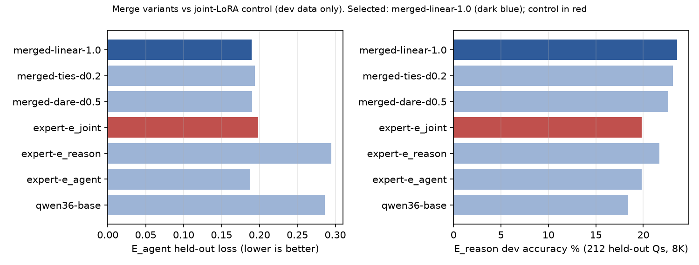
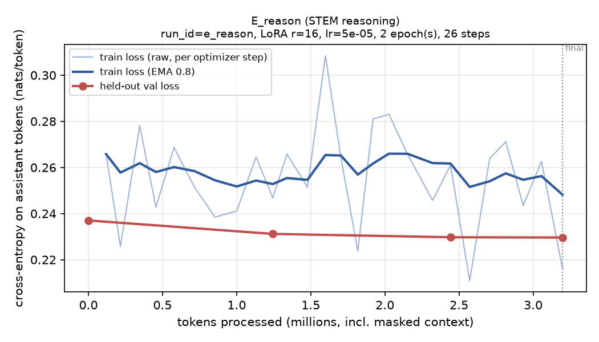
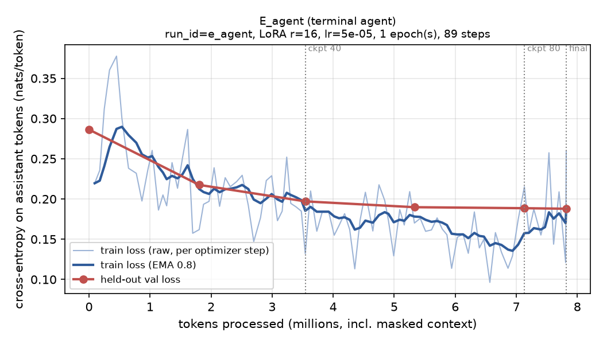
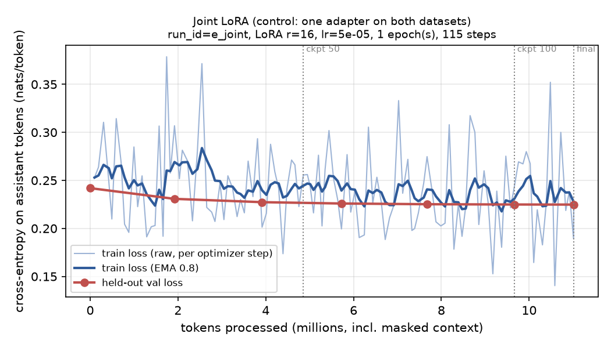

# Multi-expert training and model merging on Qwen3.6-35B-A3B

[中文版](README.md)

Two LoRA experts specialised in different capabilities plus a joint-training control are trained on **Qwen/Qwen3.6-35B-A3B** (a 35B-parameter MoE with ~3B active). Three merging methods are compared, and Base, each expert and the final merged model are evaluated on **HLE, Terminal-Bench 2.0, SWE-bench Pro V2 HARD-51 and ASI-Bench**.

> **Status (2026-10-17 06:45 UTC, all runs finished)**: training, merging and merge selection are done; **all four benchmarks are complete for Base and the final merged model**; E_agent's Terminal-Bench target evaluation is complete (same local inference setup as Base / merged; a resume after a reboot ran without the vLLM key and produced 58 trials failing with 401, which were deleted and re-run with the correct setup); one E_agent SWE-Pro run is invalid because of mismatched inference hardware (Section 6, item 9). All result tables are produced from raw logs by `scripts/summarize.py`.
> The experiment was done on limited compute (3x RTX A6000 locally plus about $200 of cloud credit) in a fixed time window. **Every deviation from the task spec or the model card is listed in [Section 6](#6-known-limitations-and-deviations).**

## 0. Submission

| Item | Link / version |
|---|---|
| Code repository | https://github.com/xutianliang-128/qwen36-35b-takehome |
| Base model | [Qwen/Qwen3.6-35B-A3B](https://huggingface.co/Qwen/Qwen3.6-35B-A3B) @ `995ad96eacd98c81ed38be0c5b274b04031597b0` |
| E_reason (STEM-reasoning expert, LoRA) | [tianlix/qwen36-35b-a3b-e-reason-lora](https://huggingface.co/tianlix/qwen36-35b-a3b-e-reason-lora) @ `5cd762da` |
| E_agent (terminal / agent expert, LoRA) | [tianlix/qwen36-35b-a3b-e-agent-lora](https://huggingface.co/tianlix/qwen36-35b-a3b-e-agent-lora) @ `3f7904b1` |
| Final merged model merged-linear-1.0 | [tianlix/qwen36-35b-a3b-merged-linear-lora](https://huggingface.co/tianlix/qwen36-35b-a3b-merged-linear-lora) @ `18e91e49` (sum of two LoRAs stored exactly as a rank-32 LoRA; merge recipe included) |
| Control E_joint (jointly trained LoRA) | [tianlix/qwen36-35b-a3b-e-joint-lora](https://huggingface.co/tianlix/qwen36-35b-a3b-e-joint-lora) @ `69e1848a` |

## 1. Research questions

1. For a 35B MoE that has already had heavy post-training, do **a few small LoRA experts, split by capability domain**, improve their target benchmarks?
2. When the experts are **merged into one model**, do the capabilities add up, survive or interfere? When the expert task vectors are nearly orthogonal, does plain addition or TIES / DARE work better?
3. Is **"train experts separately, then merge"** better or worse than **"train one adapter on the union of the data"**?

## 2. Experiment matrix

| Model | Description | HLE | Terminal-Bench 2.0 | SWE-bench Pro HARD-51 | ASI-Bench (B4) |
|---|---|---|---|---|---|
| Base | official weights | ✅ | ✅ | ✅ | ✅ |
| E_reason | STEM-reasoning expert | ✅ (target) | — | — | — |
| E_agent | terminal / agent expert | — | ✅ (target) | invalid, see 6.9 (target) | — |
| **merged-linear-1.0** | E_reason + E_agent, task vectors added | ✅ | ✅ | ✅ | ✅ |
| merged-ties-d0.2 / merged-dare-d0.5 | merge ablations | dev only | — | — | — |
| E_joint | control: joint training on both datasets | dev only | — | — | — |

E_reason targets HLE. E_agent targets Terminal-Bench and SWE-bench Pro. ASI-Bench is an integrated research benchmark with no dedicated expert; it tests whether merging combines capabilities.

## 3. Results

### 3.1 Benchmarks (primary metric, %)

| Benchmark (primary metric) | Base | E_reason | E_agent | merged-linear-1.0 | Merged − Base (paired bootstrap 95% CI) |
|---|---|---|---|---|---|
| HLE, 2500 questions incl. images (accuracy, 8K thinking budget + forced answer) | 14.32 | 14.48 | — | **12.60** | **−1.72 [−3.08, −0.36]** (significant regression) |
| Terminal-Bench 2.0, 89 tasks (success rate, 1 run) | 41.57 | — | 33.71 (-7.87 [-16.85, 1.12] vs Base) | 34.83 | −6.74 [−14.61, 0.00] |
| SWE-bench Pro V2 HARD-51, 51 tasks (resolved rate, patch-replay re-grade) | 31.37 | — | invalid* | 31.37 | 0.00 [−13.73, +13.73] |
| ASI-Bench seed31415, B4 (local non-official score, %; 58/60 gradable) | 7.43 | — | — | **11.50** | **+4.07 [+0.31, +8.79]** (significant gain) |
| **Macro average of the four** | **23.67** | — | — | **22.57** | **−1.10 [−5.47, +2.84]** (the +3 target was not met) |

- E_reason vs Base on HLE: **+0.16 pp, 95% CI [−1.28, +1.56]**, not significant.
- Full numbers, per-task results and confidence intervals are in `results/summary.csv`, `analysis/per_task.csv` and `analysis/uncertainty.json`; `python scripts/summarize.py` regenerates them from the raw results.

**HLE details**

| Model | Accuracy, plain 8K truncation | Truncated | Accuracy after forced answer | Text-only | With images | Calibration error |
|---|---|---|---|---|---|---|
| Base | 2.68 | 83.0% | 14.32 | 14.50 | 13.16 | 82.5 |
| E_reason | 3.12 | 78.0% | 14.48 | 14.74 | 12.87 | 82.1 |
| merged-linear-1.0 | 3.56 | 72.0% | 12.60 | 12.60 | 12.57 | 84.3 |

### 3.2 Dev set (used only to choose the merge configuration; no benchmark data)

| Model | E_reason dev accuracy (212 Qs, k=1, 8K) | E_agent held-out loss | E_reason held-out loss |
|---|---|---|---|
| Base | 18.40 | 0.2863 | 0.2371 |
| E_reason | 21.70 | 0.2951 | 0.2298 |
| E_agent | 19.81 | **0.1879** | 0.2434 |
| E_joint (control) | 19.81 | 0.1983 | **0.2278** |
| **merged-linear-1.0 (selected)** | **23.58** | 0.1898 | 0.2346 |
| merged-ties-d0.2 | 23.11 | 0.1938 | 0.2357 |
| merged-dare-d0.5 | 22.64 | 0.1903 | 0.2350 |



### 3.3 Key findings

1. **Merging keeps both experts' capabilities** on dev data: the merged model's agent held-out loss (0.190) is close to E_agent's (0.188), and its reasoning dev accuracy (23.6%) is higher than both E_reason (21.7%) and Base (18.4%).
2. **"Train separately, then merge" beats "train jointly"**: with identical data exposure and hyperparameters, E_joint's reasoning dev accuracy (19.8%) is 3.8 points lower than the merge, and its agent loss is also higher (0.198 vs 0.190).
3. **The two task vectors are nearly orthogonal**: mean per-module cosine similarity is about −0.006 and the sign-conflict rate is about 50% (random-like). In this regime, TIES trimming and DARE dropping only discard useful updates, so **plain addition works best**.
4. **The merge significantly improves ASI-Bench (+4.07, CI [+0.31, +8.79]) and significantly regresses HLE (−1.72, CI [−3.08, −0.36])**. ASI's research tasks need writing, running and debugging code on data, which is E_agent's skill, plus scientific knowledge, so the gain is consistent with capabilities combining. The dev reasoning gain, however, does not transfer to HLE: Our reasoning data (WebInstruct, university level) is far from HLE's frontier-expert distribution. The merged model thinks more briefly (72% truncated vs 83%) but answers less accurately after forced answering, which suggests **"more concise thinking" can cost depth on hard problems**. This is the most important negative result of the study.
5. **TB2 and SWE-Pro**: the merge is 6.7 points lower on TB2 (CI upper bound 0, borderline) and unchanged on SWE-Pro. Timeouts are similar (Base 31, merged 30); on TB2 the merge loses 9 tasks and gains 3; of the 9 lost, 6 were declared complete but failed verification and 3 timed out (see `analysis/failures.md`). **The four-benchmark macro average is −1.10 [−5.47, +2.84], short of the +3 target**: the ASI gain is cancelled by the HLE and TB2 losses. Also, **Base timed out on 31/89 TB2 tasks** (3-hour limit). Local A6000 inference is slow, and in Terminus-2 63% of wall time is spent waiting for commands (measured in a pilot), which drives the timeout rate up. The conditions are identical for every model.

6. **E_agent is below Base on TB2 (33.71 vs 41.57, −7.87 [−16.85, +1.12])**: it loses 12 tasks and gains 5; median turns per task 30 (Base 16), timeouts 35 (Base 31). Our hypothesis: shortening command wait durations in training (to cut idle waiting) made the model poll more often, and on local A6000 inference every extra turn regenerates a thinking block, so total time and timeouts went up. The "less idle waiting" design backfired under slow inference; this still needs a controlled ablation.

## 4. Method

### 4.1 Base model and pinned versions

| Item | Value |
|---|---|
| Base | Qwen/Qwen3.6-35B-A3B @ `995ad96e` (`Qwen3_5MoeForConditionalGeneration`, 35.95B params; 40 layers = 30 linear-attention + 10 full-attention; 256 routed experts, top-8, plus 1 shared expert per layer) |
| Tokenizer / chat template | from the same revision (`tokenizer_config.json`, `chat_template.jinja`) |
| Precision | bf16 everywhere; no quantization for training or evaluation |
| Inference | vLLM 0.30.0, TP=2, `--reasoning-parser qwen3 --tool-call-parser qwen3_coder`, max-model-len 262144, thinking on, `VLLM_USE_FLASHINFER_SAMPLER=0` (same locally and on Modal) |
| Training stack | torch 2.13.0+cu130, transformers 5.19.0, peft 0.21.2, flash-linear-attention 0.5.2 |
| Evaluation stack | harbor 0.24.0, modal 1.6.1, mini-swe-agent 2.4.6, asibench 0.2.0, litellm 1.105.1 |

**Why not 7B**: measured bf16 LoRA on 35B fits on 3x A6000 (sequences up to 32K, ~1,350 tokens/s, 30GB peak per GPU), so the 35B base was kept.

### 4.2 Expert design

| Expert | Capability domain | Target benchmark | Rationale |
|---|---|---|---|
| E_reason | STEM reasoning (math, physics, chemistry, biology, CS) | HLE | knowledge-and-reasoning QA, no tools |
| E_agent | multi-step terminal / repository work | Terminal-Bench, SWE-bench Pro | both are "observe, act, read output" agent loops; the planned separate SWE and terminal experts were merged into one for time |
| (none) | — | ASI-Bench | research tasks need both code execution and scientific knowledge; used to test whether merging combines capabilities. It has only 60 tasks and is the task author's own benchmark, so contamination-free in-distribution training data is hard to find |

### 4.3 Data

| | E_reason | E_agent |
|---|---|---|
| Source | [TIGER-Lab/WebInstruct-verified](https://huggingface.co/datasets/TIGER-Lab/WebInstruct-verified) @ `3e8a350b3a` | [NiuNiu0110/TMax-Agent-SFT-terminus](https://huggingface.co/datasets/NiuNiu0110/TMax-Agent-SFT-terminus) @ `7d74fd38a3` (verifier-successful trajectories from allenai/tmax-sft, generated by Qwen3.6-27B) |
| License | Apache-2.0 | ODC-BY |
| Construction | **self-distillation by rejection sampling**: Base samples each question twice (thinking, temperature 1.0); a programmatic checker verifies the `\boxed{}` answer (numbers within 1%, multiple-choice letters, booleans, math-verify expression equivalence); **only the shortest correct solution per question is kept** | bash tool-call format **rewritten turn by turn into Terminus-2 JSON** (official prompt template, `analysis/plan/commands/task_complete`, two-step completion confirmation), with per-command wait durations (0.1–30 s) |
| Difficulty strata | university and PhD only, with quotas following HLE's subject mix (math 495, physics 246, chemistry 147, biology 100, CS 84, ...) | 1,062 task groups, trajectories sampled per group |
| Cleaning | only answer types a program can check; drop truncated (16K) and answers without `\boxed{}` | remove format-error retry turns and upstream artefacts such as `(exit_code=N)`; drop 73 trajectories that never finished; drop samples over 16K |
| Dedup / decontamination | 13-gram overlap against all 2500 HLE questions + answers: **0** overlaps; question-level dedup | 13-gram overlap against all 89 TB2 instructions + exact task-name match: **0** overlaps; **every public trajectory set recorded on TB2 tasks was excluded** (e.g. `*terminal-bench-2*-trajectories`) |
| Size | 600 questions × 2 samples → 227 questions answered correctly at least once → 207 train / 20 val, 1.6M tokens | 5,372 converted → 1,500 train (1,411 after the length filter) / 60 val (split by task group), 7.8M tokens |
| Independent dev set | 212 held-out questions, used only for merge selection | 60 held-out samples split by task group |
| Why the sizes differ | reasoning data is self-generated and expensive (~1,100 questions/hour locally); small, so 2 epochs | agent trajectories exist already but are long (5.5K tokens on average); 1 epoch to avoid overfitting |

**Sample format**: loss is computed only on the model's own reply. Each agent sample **trains exactly one target turn**, with history turns rendered without reasoning. This matches evaluation, where Terminus-2 resends the history without earlier thinking (`interleaved_thinking=false`).

Data manifests and checksums are in `data/*/manifest.sha256`; data-construction code is in `src/data/`.

### 4.4 Training

All experts use **bf16 LoRA** (`src/train/train_lora.py`): layer-wise model parallelism over 3x A6000, gradient checkpointing, chunked loss (the full 248K-vocabulary logits are never materialised), and the `grouped_mm` MoE expert kernel (2.5x faster than eager).

| | E_reason | E_agent | E_joint (control) |
|---|---|---|---|
| LoRA target modules | full-attention q/k/v/o (10 layers), linear-attention in_proj_qkv / in_proj_z / out_proj (30 layers), shared-expert gate/up/down (40 layers) | same | same |
| Frozen | router, 256 routed experts (3D params), vision tower, embeddings, lm_head | same | same |
| rank / alpha / dropout | 16 / 32 / 0 | 16 / 32 / 0 | 16 / 32 / 0 |
| Trainable params | 19.17M | 19.17M | 19.17M |
| LR / schedule | 5e-5, cosine, 5% warmup | same | same |
| Batch | 16 examples (micro-batch 1, grad accumulation 16) | same | same |
| Epochs / steps | 2 / 26 | 1 / 89 | 1 / 115 |
| Max length | 20,480 | 16,384 | 20,480 (agent part filtered at 16,384) |
| Seed | 42 | 42 | 42 |
| Training time | 40.3 min | 96.0 min | 138.0 min |
| Throughput | 1,321 tokens/s | 1,358 tokens/s | 1,331 tokens/s |
| Peak memory per GPU | 30.0 GiB | 30.0 GiB | 30.0 GiB |
| Checkpoint size (adapter) | 76.8 MB | 76.8 MB | 76.8 MB |
| Val loss (start → end) | 0.2370 → 0.2296 | 0.2863 → 0.1879 | 0.2419 → 0.2248 |
| Checkpoint selection | final checkpoint (never selected on benchmarks) | same | same |

**Why LoRA, not QLoRA or full fine-tuning**:
- Full fine-tuning needs over 400GB of optimizer state.
- The routed experts are fused 3D parameters, and bitsandbytes only quantizes `nn.Linear`, so QLoRA saves little memory. An adapter trained against a quantized base would also not match the bf16 base used for merging and serving.
- **Freezing the router and routed experts** is a choice made for merging: if each expert changed routing, the merged model would inherit conflicting routing decisions.

Loss curves (raw training loss plus EMA 0.8, validation loss, checkpoints marked):

| E_reason | E_agent | E_joint |
|---|---|---|
|  |  |  |

### 4.5 Control: multi-expert merge vs single-model joint training

E_joint trains **one** LoRA on **the union of both training sets** with the same per-example exposure as the two experts (reasoning data repeated twice = its 2 epochs, agent data once) and identical hyperparameters. Results are in 3.2 and finding 2 of 3.3.

### 4.6 Merging

Tool: `src/merge/merge_experts.py`. Every method operates on the **dense task vectors ΔW = (alpha/r)·B·A**; A and B are never averaged separately, which is mathematically incorrect. Only the 250 LoRA-targeted modules change; every other tensor is copied byte for byte from the base.

| Method | Principle | When it helps | Config |
|---|---|---|---|
| Task Arithmetic (linear) | W = W₀ + Σλᵢ·ΔWᵢ | most faithful when task vectors conflict little | λ = 1.0 |
| TIES | keep the top-density magnitudes of each ΔW → elect a sign per entry by summed mass → average only agreeing values | reduces cancellation when task vectors conflict | density 0.2, λ = 1.0 |
| DARE-TIES | randomly drop (1−density) of each ΔW and rescale by 1/density, then TIES | when task vectors are redundant | density 0.5, seed 0 (CPU RNG, so local and Modal merges are identical) |

**Parameter-conflict analysis** (written automatically during merging, `merge_diagnostics.json`): mean per-module cosine similarity between the two experts is −0.0055 (−0.019 to 0.002 by module type), and the sign-conflict rate where both are non-zero is 50.2%. The task vectors are **nearly orthogonal**, so adding them barely cancels anything.

**Selection rule** (fixed before any merged model was evaluated on a benchmark; see `src/merge/select_merge.py`): on dev data, rank candidates by E_reason dev accuracy (higher is better) and by E_agent held-out loss (lower is better); choose the lowest mean rank, tie-break on the former. **merged-linear-1.0** was selected and frozen before benchmark evaluation.

The final merged model was evaluated once on each benchmark, and **no configuration was changed in response to benchmark results**.

## 5. Evaluation protocol

Within each benchmark every model uses **the same task set, the same agent harness and prompts, the same inference server, and the same sampling parameters and budgets**: thinking on, preserve_thinking / interleaved_thinking off, bf16 without quantization. Environment failures are counted separately and **never removed from the denominator**.

| | HLE | Terminal-Bench 2.0 | SWE-bench Pro V2 HARD-51 | ASI-Bench |
|---|---|---|---|---|
| Source / version | [cais/hle](https://huggingface.co/datasets/cais/hle) @ `5a81a4c7`, test split, 2500 questions (342 with images) | Harbor registry `terminal-bench@2.0`, 89 tasks; per-task SHA-256 of the local snapshot in `configs/eval/terminal_bench_2.0_manifest.json` | [scaleapi/SWE-bench_Pro-os](https://github.com/scaleapi/SWE-bench_Pro-os) @ `66f92766` (v2.0.0) `v2/hard51_ids.txt`; HF `ScaleAI/SWE-bench_Pro` @ `2d52cb3d`, config `hard` | [apexin-ai/ASI-Bench](https://github.com/apexin-ai/ASI-Bench) @ `cf07cb89` (v0.2.0); data `Apexintelligence-AI/ASI-Bench-seed31415` @ `0fa14219` |
| Hard split | — | — | official: tasks failed by at least 2 of 5 model families under the locked protocol, minus 3 ambiguous tasks | — |
| Harness / agent | direct calls, no tools; official system prompts | Harbor 0.24.0 + Terminus-2 (json parser) | official host-side mini-swe-agent (`v2/tooling/host_mini_swe.py`, `mini_toolcall.yaml` prompts unchanged), sandbox without network, **official patch_replay re-grade on pristine images** | official opencode_cli adapter (opencode-ai@1.17.15), sandbox=task |
| Sampling | T=1.0, top_p 0.95, top_k 20, presence_penalty 1.5 | T=1.0, top_p 0.95, top_k 20, max_tokens 80K, 256K context | T=1.0, top_p 0.95, top_k 20 | opencode defaults |
| Budget / timeout | 8K thinking; on overflow, Qwen's thinking-budget recipe forces an answer of at most 1K more tokens | 3 hours; 32 CPU / 48GB as resource limits | 50 minutes per task (official) | 3 hours per task (official default) |
| Grading | official judge prompt, o3-mini-2025-01-31, structured output | official verifier | official verifier (patch replay) | `asibench score --repo seed31415` with public references, **non-official** |
| Primary metric | accuracy (after forced answer) | task success rate | resolved rate | total score / max score |
| Inference hardware | Modal 2x H100 (same for every model) | local 2x A6000, 32 concurrent trials (same for every model) | Modal 2x H100, 26 concurrent | Modal 2x H100, 60 concurrent |
| Runs | 1 | 1 (vLLM random seed) | 1 | 1 |

**Differences from the model card** (all are this experiment's settings; **no claim to reproduce official scores**):
- HLE: the model card does not disclose a thinking budget; this experiment uses 8K plus forced answering.
- TB2: uses the task-specified 32 CPU / 48GB / 3 hours, whereas the official tasks request only 1–8 CPU, 2–16GB and 15–120 minutes; 1 run instead of 5.
- SWE-Pro: the model card used Qwen's internal scaffold on an internally corrected task set; this experiment uses the official v2 HARD-51 and the official mini-swe-agent.
- ASI-Bench: B4 only; seed31415 local scoring is non-official.

**ASI-Bench anti-cheating measures**: the public seed31415 ships reference answers next to every instance, and the `task` sandbox has no filesystem isolation. Smoke tests showed that (1) the agent could read the reference answers, and (2) because opencode infers its project directory from `$PWD`, the agent read `custom_scorer.py` and `task_eval.yaml` from the ASI repo root. Before the real runs:
- the agent only gets **a copy of the data with every `reference/` removed**;
- inside the container the task dirs keep only `task_meta.yaml`, `task.yaml` and `prompt_b*.md`; scorers, generators, example tasks and the git history are deleted;
- a wrapper pins opencode's `$PWD` to the task workspace.

After the runs, all agent logs were audited for keywords (`hidden_truth`, `/reference/`, `custom_scorer`, `task_eval.yaml`, the reference dataset URL): **0 hits** (`results/*/asi-bench/*/audit_hits.txt`).

## 6. Known limitations and deviations

Compute was the lab's 3x A6000 (the server has no Docker and no rootless-podman rights) plus a personal Modal account that hit its spend cap twice (final cap $200). Trade-offs made under these constraints:

1. **Number of experts**: 3 were planned (SWE, terminal, reasoning); merged into 2 for time.
2. **Terminal-Bench was run once** (the spec asks for the mean and std of 5 runs), so run-to-run variance is not reported, only paired bootstrap CIs. E_agent's TB2 evaluation did not finish before the deadline.
3. **HLE thinking budget is 8K**: at 16K one model took 6 hours locally. At 8K, 83% of Base responses were truncated, so Qwen's thinking-budget forced answering was added. This rule was added **after seeing Base's truncation rate**, but it was fixed before any expert or merged result was seen, and it applies to every model identically.
4. **ASI-Bench is B4 only** (60 of 240 instances) with seed31415 local non-official scoring. Two tasks (TSP, Max-3-SAT) need Docker to grade and cannot be scored for either model; per the official rule they leave the denominator, and comparisons use only instances scored for both models.
5. **SWE-bench Pro (Base / merged) and ASI inference ran on Modal H100**, TB2 inference on local A6000. Hardware is identical across models within each benchmark, but absolute speed differs across benchmarks.
6. **E_reason's data is small** (207 examples) and much easier than HLE. **E_agent's data comes from Qwen3.6-27B trajectories**, not this model's own successful trajectories, which would have needed far more sandbox budget.
7. **The server rebooted unexpectedly three times** (10-15 03:58 and 14:15 UTC, 10-16 12:50 UTC kernel upgrade), losing about 4 hours; E_agent's SWE-Pro run was therefore not finished at the deadline; handled afterwards with `@reboot` cron entries and resumable driver scripts.
8. Early partial HLE runs on A6000 (16K / 8K pilots) are archived as pilots only (`results/qwen36-base/hle/pilot-*`) and are not reported.
9. **E_agent's SWE-Pro result is invalid and excluded from every comparison**: Base and merged SWE-Pro inference ran on Modal 2x H100; with the Modal budget near its cap, E_agent's run was done on local 2x A6000 at 26 concurrent tasks, which is 3–4x slower. Under the official 50-minute budget all 51/51 tasks timed out (e.g. only 8 model calls in 50 minutes on one task), scoring 0. That measures hardware, not the model, so it is voided; raw logs are kept in `results/expert-e_agent/swebench-pro/INVALID-local-a6000-swepro-run1/`. It needs a re-run under the same H100 setup.

## 7. Cost and time

| Item | Value |
|---|---|
| Local GPUs (RTX A6000, free) | ~50 GPU-hours (training ~14.3; data generation ~6; TB2 ~24; dev and pilots ~6) |
| Modal (H100 inference + CPU sandboxes) | $154 as of 05:00 UTC (vLLM / H100 $89.6, TB2 / SWE sandboxes $48.5, ASI containers $16.0); final numbers in `logs/resources.csv` |
| OpenAI (HLE judge o3-mini + ASI task judges gpt-5.5) | ~$40 (estimate) |
| Active work hours | ~10 h (self-reported; the rest was unattended background runs), see `logs/worklog.md` |

GPU-hours = number of GPUs × wall time; Modal costs come from the `modal.billing` export.

## 8. Reproduction

```bash
# 0) environments (three isolated conda envs; run everything with PYTHONNOUSERSITE=1)
conda create -n qwen36-train python=3.12 && pip install torch==2.13.0 --index-url https://download.pytorch.org/whl/cu130 \
  && pip install transformers==5.19.0 peft==0.21.2 accelerate flash-linear-attention pyyaml
conda create -n qwen36-vllm python=3.12 && pip install vllm==0.30.0
conda create -n qwen36 python=3.12 && pip install harbor==0.24.0 modal==1.6.1 mini-swe-agent==2.4.6 dockerfile-parse math-verify httpx pandas matplotlib
# .env: VLLM_API_KEY, OPENAI_API_KEY (judges), HF_TOKEN (cais/hle is gated)

# 1) data
python src/data/build_reason_pool.py --out data/reason                       # pick questions + hold out dev
bash scripts/serve_local.sh                                                    # local vLLM (base)
python src/data/gen_rft.py --pool data/reason/pool_train.jsonl --out data/reason --max-questions 600
python src/data/build_sft_reason.py --samples data/reason/samples.jsonl --out data/reason   # HLE decontamination + shortest correct
python src/data/build_sft_agent.py --out data/agent --n-samples 1500           # TMax -> Terminus-2, TB2 decontamination

# 2) training, merging, selection, evaluation (resumable drivers)
bash scripts/run_all.sh          # E_agent, E_joint training -> merges -> dev selection -> TB2 / SWE-Pro
bash scripts/hle_modal_queue.sh  # HLE (Modal)    bash scripts/hle_force_queue.sh  # thinking-budget forcing + judging
bash scripts/asi_queue.sh        # ASI-Bench B4 (Modal)   bash scripts/asi_score.sh qwen36-base merged-linear-1.0
bash scripts/swepro_queue.sh     # SWE-Pro HARD-51 (Modal inference)

# 3) tables and figures (regenerated from raw results)
python scripts/summarize.py && python scripts/plot_curves.py
```

Single expert: `python src/train/train_lora.py --config configs/train/e_reason.yaml` (others in `configs/train/`).
Merge: `python src/merge/merge_experts.py --method linear --lam 1.0 --expert e_reason=checkpoints/e_reason/final --expert e_agent=checkpoints/e_agent/final --out <dir>`.

## 9. Layout and logs

```
configs/train/        training configs for experts and control (fixed before training)
configs/eval/         frozen benchmark configs and task lists (TB2 SHA-256 manifest, HARD-51 IDs)
data/                 data docs and manifests (data/README.md, */manifest.sha256); large files not committed
src/data/             question selection, rejection sampling, answer checking, SFT construction
src/train/            LoRA training, speed test
src/merge/            merging (linear / TIES / DARE-TIES + conflict diagnostics) and dev selection
src/eval/             HLE generation / forced answering / judging, held-out loss
modal_app/            vLLM tunnel, merging and ASI runner on Modal
scripts/              drivers, benchmark entry points, summarize.py, plot_curves.py
checkpoints/<expert>/ metrics.jsonl (per-step training metrics), train_metadata.json; weights on HF
curves/               loss curves, merge comparison, and source/*.csv
results/<model>/<benchmark>/<run>/   per-task outputs, grades, errors; results/dev/ = dev set
analysis/             per_task.csv, uncertainty.json, failures.md (failure-case analysis)
logs/                 training, evaluation, merge, serving and error logs; worklog.md = hours and cost
docs/engineering_notes.md   engineering details and pitfalls
```

Logs are plain text or JSONL: per-step training metrics in `checkpoints/*/metrics.jsonl`, evaluation run logs in `logs/`, and every Harbor trial has its own `result.json` / `trial.log`.

## 10. Next experiments

1. **Train E_reason on harder, HLE-like data and keep longer reasoning**: selecting the shortest correct solution may hurt depth on hard problems; select length by difficulty stratum instead.
2. **Train E_agent on this model's own successful sandbox trajectories** (rejection sampling / RFT), and run TB2 five times to estimate variance.
3. **Per-module or per-layer merge coefficients**: with nearly orthogonal task vectors, try λ > 1, or down-weight reasoning-related layers, to see whether the HLE regression disappears.
4. **Run ASI-Bench on all of B1–B4** and submit seed42 in Docker for official scoring.
5. Split the SWE and terminal experts (3 experts) to test how expert granularity affects merging.
6. Ablate E_agent's wait-duration rewrite (original vs per-command shortened durations) at equal inference speed, comparing TB2 turns, timeouts and success.
